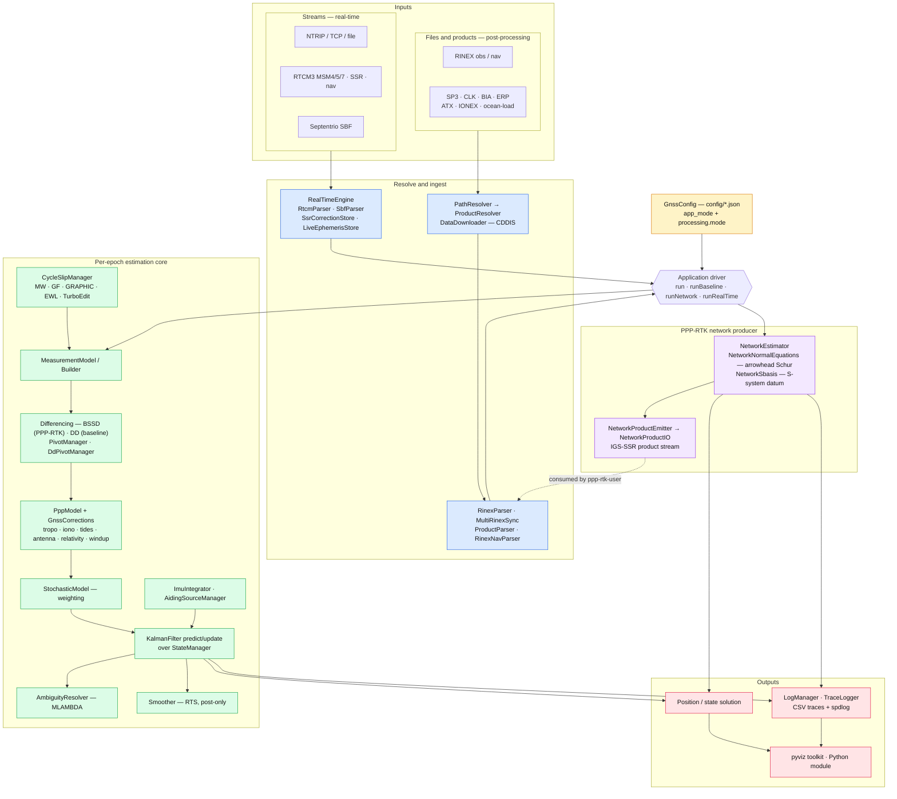

# GnssProcessor

A **C++17 GNSS post-processing and real-time engine** for high-precision positioning.
It implements Precise Point Positioning (PPP), uncombined **PPP-RTK**, double-differenced
baseline processing, and a minimum-constraint **S-system network producer/consumer** — with
integer ambiguity resolution (MLAMBDA), optional IMU tight coupling, and a backward RTS
smoother. It runs equally as a batch post-processor over RINEX + IGS products or as a live
engine over NTRIP / RTCM3 / Septentrio SBF streams.

> **Status:** actively developed research & engineering codebase. `main` is the integration
> branch. A substantial GoogleTest suite (~550 cases across 33 files) guards the numerics.

---

## Table of contents

- [Highlights](#highlights)
- [Processing modes](#processing-modes)
- [Architecture](#architecture)
- [Quick start](#quick-start)
- [Building](#building)
- [Configuration](#configuration)
- [Data & products](#data--products)
- [Repository layout](#repository-layout)
- [Capabilities in depth](#capabilities-in-depth)
- [Real-time streaming](#real-time-streaming)
- [PPP-RTK network mode](#ppp-rtk-network-mode)
- [Testing](#testing)
- [Tooling & Python](#tooling--python)
- [Documentation](#documentation)
- [License](#license)

---

## Highlights

- **Uncombined and ionosphere-free** measurement models with a variable-dimension Extended
  Kalman Filter — state layout (position, clocks, ZWD, per-satellite ionosphere, ambiguities,
  code/phase biases, system-time offsets) is owned dynamically by `StateManager`.
- **Integer ambiguity resolution** via LAMBDA / MLAMBDA integer least-squares, with float,
  continuous, instantaneous, and fix-and-hold modes, WL-only (MW-resolved widelane) fixing,
  and fixed-failure-rate acceptance.
- **Multi-GNSS**: GPS, Galileo, BeiDou, and GLONASS (per-FCN code inter-frequency bias).
- **Full physical modeling**: GMF/VMF3/GPT3 troposphere, Klobuchar/IONEX/spherical-harmonic
  and higher-order ionosphere, IGS ANTEX PCO/PCV, solid-earth/ocean/pole/atmospheric tides,
  relativity, phase wind-up, satellite attitude/eclipse.
- **Real-time engine** over NTRIP v2 (HTTP/HTTPS/TLS), raw TCP, or file replay — RTCM3
  MSM4/5/7, broadcast ephemeris, station coordinates, and IGS-SSR orbit/clock/bias
  corrections; plus native Septentrio SBF ingestion.
- **PPP-RTK network producer**: a joint multi-station estimator that solves satellite clocks
  and code/phase biases on an arrowhead-Schur normal-equation kernel under an explicit
  S-system datum, emits an IGS-SSR-convention product stream, and closes the loop through a
  held-out consumer station.
- **Backward RTS smoother**, IMU/INS tight coupling, and a pluggable cycle-slip
  detection/repair stack (Melbourne-Wübbena, geometry-free, GRAPHIC, EWL, TurboEdit).

## Processing modes

The engine is driven by **two orthogonal axes** in the config: `app_mode`
(post-processing vs. real-time) and, within post-processing, `processing.mode`.

| `processing.mode`      | What it does |
| ---------------------- | ------------ |
| `PPP`                  | Single receiver, ionosphere-free, external precise orbit/clock products. |
| `PPP-RTK`              | Single receiver, **uncombined**, between-satellite single-difference, phase clock + per-satellite ionosphere, optional AR. |
| `Baseline-Single`      | Double-differenced single baseline (one rover + one reference station). |
| `Baseline-Multi`       | Double-differenced star topology (N rovers against one master reference). |
| `ppp-rtk-network`      | **Network producer** — minimum-constraint S-system joint multi-station estimator emitting satellite clock + code/phase bias (+ atmosphere). |
| `ppp-rtk-user`         | **Network consumer** — uncombined PPP-RTK that ingests the network SSR products and cross-checks the S-basis. |

Setting `app_mode: "real_time"` runs the streaming `RealTimeEngine` instead, selected further
by `realtime.input_type` (`file` \| `ntrip` \| `tcp`) and `realtime.input_format`
(`rtcm` \| `sbf`).

## Architecture

A single `Application` driver, configured by one JSON file, dispatches to one of four run
methods. Every input path — batch files/products or live streams — is normalized through the
ingest layer before feeding the same **per-epoch estimation core**; the PPP-RTK network
producer runs as a parallel path that emits an IGS-SSR product stream, which the `ppp-rtk-user`
consumer reads back in (the dashed edge). Colors group the layers:
**config**, **ingest**, **estimation core**, **network**, and **outputs**.



## Quick start

```powershell
# 1. Build (see "Building" for the vcvars/CMake preset details)
cmake --build build/x64-Debug --target gnss_processor

# 2. Populate the bundled fixture data once after a fresh clone
python scripts/bootstrap_internal_data.py

# 3. Run a scenario — the argument is a self-contained config file
build/x64-Debug/gnss_processor.exe config/ppp_rtk_internal.json
```

Run with no argument and it defaults to `config/ppp_rtk_internal.json`. Every file in
[`config/`](config/) is a complete, standalone scenario — there is no config layering.

## Building

**Toolchain:** MSVC (Visual Studio 2022) + CMake + Ninja, targeting C++17. The C language is
also required — the vendored IAU SOFA library (`third_party/sofa/`) is ANSI C.

**Dependencies** (resolved through [vcpkg](https://github.com/microsoft/vcpkg)):
Eigen3, spdlog, pybind11, GoogleTest, netCDF, libcurl, zlib, and OpenMP (optional; enables
Eigen dense-kernel threading). Python 3.13 is used for the pybind11 module. SOFA is vendored
and built as a separate warning-suppressed static lib.

> **Note on the shell.** The default shell does not source `vcvars64.bat`, so a naive
> `cmake --build` fails with `Cannot open include file: 'memory'`. Wrap the build in the
> MSVC environment:

```powershell
$vcvars = "C:\Program Files\Microsoft Visual Studio\2022\Enterprise\VC\Auxiliary\Build\vcvars64.bat"
cmd /c "`"$vcvars`" >nul && cmake --build C:\GnssProcessor\build\x64-Debug 2>&1"
```

Build trees live at `build/x64-Debug` and `build/x64-Release`.

**Targets** (explicit source lists in [`CMakeLists.txt`](CMakeLists.txt) — no globbing except
the vendored SOFA):

| Target                     | Kind          | Purpose |
| -------------------------- | ------------- | ------- |
| `gnss_core`                | static lib    | The entire engine. |
| `gnss_processor`           | executable    | Main driver (`gnss_processor.exe <config.json>`). |
| `gnss_tests`               | executable    | GoogleTest unit suite. |
| `gnss_processor_module`    | `.pyd`        | pybind11 Python module (copied to `python/gnss_processor.pyd`). |
| `gnss_simulator`           | executable    | Multi-GNSS RINEX scenario simulator + truth verifier. |
| `gnss_rtcm_diag`           | executable    | RTCM3 capture inspector (message histogram, coords, SSR, MSM7). |
| `gnss_sbf_diag`            | executable    | Septentrio SBF block/observation inspector. |
| `gnss_meas3_xcheck`        | executable    | SBF Meas3Ranges vs. MeasEpoch cross-check. |
| `gnss_atx_diag`            | executable    | ANTEX PCO/PCV coverage inspector. |

Add `--target gnss_core` for fast library-only iteration. Doxygen docs (`--target docs`) build
when Doxygen — and, optionally, Graphviz `dot` — are on `PATH`.

## Configuration

One JSON file drives a run. Top-level scalars `app_mode` and `data_source` select the
execution axis and file provenance; the rest is grouped into sections:

| Section             | Governs |
| ------------------- | ------- |
| `processing`        | Global loop knobs: `mode`, `active_systems`, `elevation_mask_deg`, `signal_priorities` (per-constellation tracking-code priorities — **required** to make GLONASS/BeiDou non-inert), interpolation, threading. |
| `estimation`        | State-vector toggles: velocity, per-satellite code-bias estimation, between-satellite SD + sticky-pivot elevation, `ambiguity_resolution` (MLAMBDA), adaptive iono process noise. |
| `filter`            | Kalman tuning: `process_noise` (spectral densities), `initial_std` (a-priori **standard deviations**, not variances), `measurement_noise`, `stochastic_model`. |
| `model_corrections` | Per-effect `enable_*` physical-model switches (troposphere, tides, PCO/PCV, relativity, phase wind-up, higher-order iono, …). |
| `baseline`          | DD-mode knobs: `use_iono_free`, `estimate_differential_tropo`, `enable_pivot_handover`, `signal_aliasing`, plus the `baseline_fixture` preset selector. |
| `network`          | Producer/consumer: `clock_datum_station`, held-fixed `stations[]`, `product_output_path`, and the `closed_loop` consumer block. |
| `realtime`          | Streaming input: `input_type`/`input_format`, NTRIP/TCP connection, and independent `corrections` (SSR) and `ephemeris` streams. |
| `data_download`     | Production-mode fetch settings (CDDIS source/type, year/doy/station) and ATX auto-refresh. |
| `logging`           | Per-channel spdlog + CSV-trace `enable_*` flags and per-logger severity. |

Shipped configs use `//` line comments liberally to document and stash alternative values.
See [`docs/CONFIG.md`](docs/CONFIG.md) for the "which knob does what" narrative and the
field-level Doxygen in [`include/config/GnssConfig.hpp`](include/config/GnssConfig.hpp) for the
exhaustive reference.

**Selected scenario presets** in [`config/`](config/):

| File | Scenario |
| ---- | -------- |
| `ppp_internal.json` / `ppp_prod.json`            | PPP (bundled fixtures / production download). |
| `ppp_rtk_internal.json` / `ppp_rtk_internal_AR.json` | Single-station PPP-RTK (float / with ambiguity resolution). |
| `baseline_single.json` / `baseline_multi.json`   | Double-differenced baseline. |
| `ppp_rtk_network_internal.json` (+ codebias / glonass / global variants) | Network producer + closed-loop consumer. |
| `realtime_ppp_rtk.json` / `realtime_igs_ntrip.json` | Live PPP-RTK over NTRIP (IGS-RTS SSR + broadcast nav). |
| `sbf_replay.json`                                | Septentrio SBF file replay. |

## Data & products

All input-file location goes through one class — `PathResolver` — driven by the top-level
`data_source` field. Both modes share the same **date-first on-disk layout**:

```
<root>/
  <YYYY-DOY>/                 e.g. 2024-129
    products/                 SP3  CLK  BIA  ERP  *_MN.rnx (nav)
    obs/<station>/            RINEX observations (Hatanaka-decompressed)
  static/                     atx/igs20.atx   nc/EOT20_load.nc
  cache/<YYYY-DOY>/           raw .gz / .crx intermediates (production only)
```

- **`internal`** (default) — turnkey, no network. `PathResolver` globs the bundled `data/`
  tree (a CMake-baked project-root path) and matches files by station and date. Used by the
  tests and every demo run.
- **`production`** — `PathResolver` delegates to `ProductResolver`, which builds IGS
  long-name URLs and downloads any missing products from CDDIS (`.netrc` HTTP Basic auth),
  gunzips, and Hatanaka-decompresses (`crx2rnx`) as needed.

Parsed formats: RINEX 2/3 observations, RINEX 3/4 navigation, SP3 orbits, RINEX/CLK clocks,
Bias-SINEX / OSB, ERP, IGS ANTEX, IONEX/GIM, and NetCDF ocean-loading grids.

`data/` is `.gitignore`d except for README shells — populate it once after cloning:

```
python scripts/bootstrap_internal_data.py             # full set
python scripts/bootstrap_internal_data.py --no-eot20  # skip the 280 MB ocean-tide file
```

## Repository layout

```
include/            Public headers, mirroring src/core/ (heavy Doxygen; always include with
                    the subdir prefix, e.g. "filter/KalmanFilter.hpp").
  app/              Application driver (post / baseline / real-time / network entry points).
  atmosphere/       Troposphere (GMF/VMF3/GPT3), Ionosphere (Klobuchar/IONEX/SH/higher-order).
  common/           Cross-cutting types: constants, GNSS/PPP types, state, observations.
  config/           GnssConfig + enums + JSON loader helpers; primary config in src/core/config.
  corrections/      GnssCorrections, ocean-tide model.
  filter/           KalmanFilter, StateManager, Smoother (RTS), AmbiguityResolver (MLAMBDA),
                    PivotManager / DdPivotManager, ImuIntegrator, NetworkEstimator + S-basis.
  measurement/      MeasurementModel/Builder, StateInitializer, BSSD/BRSD transforms.
  model/            PppModel (uncombined PPP-RTK), StochasticModel, Antenna, attitude, geometry.
  products/         Path/Product resolvers, DataDownloader, SSR store, network product I/O,
                    live ephemeris store, RINEX nav parser.
  realtime/         NtripClient (TLS), TcpClient, RtcmStreamReader, RealTimeEngine.
  rinex/ rtcm/ sbf/ RINEX parsing + sync; RTCM3 (MSM/SSR/nav) decoders; Septentrio SBF.
  slip/             CycleSlipManager + MW/GF/GRAPHIC/EWL/TurboEdit detectors, LLI bridge.
  aiding/           IAidingSource abstraction (IMU, ZUPT) + registry/manager.

src/core/           Implementation, mirroring include/ one-to-one.
src/tools/ src/sim/ Standalone diagnostic tools and the scenario simulator.
src/bindings/       pybind11 module.
tests/              GoogleTest suite (~550 cases).
scripts/            Python utilities (bootstrap, ATX refresh, layout migration, obs fetch).
pyviz/              Python visualization toolkit (traces, maps, reports).
third_party/sofa/   Vendored IAU SOFA (ANSI C) for the CIO frame transform.
docs/               Design notes, config reference, operational runbooks.
```

## Capabilities in depth

**Estimation core**
- Extended Kalman filter over a dynamic state vector; `StateManager` is the single source of
  truth for key→index layout; optional IEKF geometry relinearization.
- Backward Rauch-Tung-Striebel smoother (post-processing only; segments break at ambiguity
  resets).
- LAMBDA / MLAMBDA integer least-squares (Teunissen 1995; Chang et al. 2005) with a ratio test,
  convergence guards, NL/WL basis, WL-only mode, and fixed-failure-rate acceptance.
- Between-satellite single-difference (PPP-RTK) with sticky pivot + S-transform handover;
  double-difference baselines with a dedicated DD pivot manager.
- GNSS/INS tight coupling: IMU strapdown ECEF mechanization with accelerometer/gyro biases as
  filter states; extensible aiding-source abstraction (IMU, ZUPT).

**GNSS & environmental modeling**
- Troposphere: hydrostatic + estimated wet ZWD, GMF / VMF3 / GPT3 mapping.
- Ionosphere: per-satellite slant states, Klobuchar, IONEX/GIM, spherical-harmonic VTEC, and
  2nd/3rd-order higher-order terms with an IGRF magnetic-field model.
- Antenna: satellite & receiver PCO/PCV from IGS ANTEX, with cross-system fallback.
- Site displacement: solid-earth tide, ocean-tide loading (EOT20), pole tide, atmospheric
  loading; relativity (Shapiro + periodic), phase wind-up, satellite attitude/eclipse.

**Quality control**
- Innovation/residual outlier screening, RAIM-style network fault isolation, per-satellite
  clock monitoring, and residual-history tracking.

## Real-time streaming

`RealTimeEngine` consumes up to three concurrent streams — a primary observation stream plus
optional independent **corrections** (SSR) and **ephemeris** streams — each configurable as
file replay, NTRIP, or raw TCP:

- **NTRIP v2 client** over HTTP or HTTPS/TLS (libcurl), with GGA upload for VRS mountpoints and
  jittered reconnect.
- **RTCM3 decoding**: MSM4/5/7 multi-GNSS observations, broadcast ephemeris, reference-station
  coordinates (1005/1006/1033/1230), and IGS-SSR orbit / clock / code+phase-bias corrections.
- **Septentrio SBF**: MeasEpoch and Meas3Ranges decoding with navigation subframe assembly.
- Observation↔SSR time-sync buffering and a live ephemeris store keep the correction and
  observation clocks aligned.

## PPP-RTK network mode

The `ppp-rtk-network` producer estimates **shared satellite parameters** (clock, code bias,
phase bias, and optionally atmosphere) jointly across a set of held-fixed stations:

- Built on an **arrowhead / Schur** normal-equation kernel (`NetworkNormalEquations`) with a
  semantic layer (`NetworkEstimator`) that gives each shared column a (satellite, parameter,
  signal) meaning.
- Solved under an explicit **minimum-constraint S-system datum** (`NetworkSbasis`) that pins
  exactly the gauge freedoms (overall clock, per-constellation phase-bias↔ambiguity, ISB).
- Serialized as an IGS-SSR-convention product stream (`NetworkProductEmitter` /
  `NetworkProductIO`), consumed closed-loop by a held-out station routed through the user-side
  PPP-RTK + AR pipeline for A/B validation.

## Testing

```powershell
cmake --build build/x64-Debug --target gnss_tests
build/x64-Debug/gnss_tests.exe          # or: ctest --test-dir build/x64-Debug
```

~550 GoogleTest cases across 33 files cover the filter core, transforms/estimation, RTCM & SBF
decoders, ILS/MLAMBDA, state-key schema, covariance re-referencing, the network estimator +
normal equations + product I/O, cycle-slip/TurboEdit, the RTS smoother frame, aiding sources,
planetary/CIO geometry, and real-time seams. A separate `gnss_simulator_selftest` exercises
the scenario simulator. See [`docs/test_suite.md`](docs/test_suite.md).

> New behavior is developed default-OFF and byte-identical where possible, so the suite can
> assert non-regression against prior runs.

## Tooling & Python

- **Diagnostic executables** — `gnss_rtcm_diag`, `gnss_sbf_diag`, `gnss_meas3_xcheck`,
  `gnss_atx_diag` (see the target table above) validate captures and coverage before a live run.
- **Simulator** — `gnss_simulator` synthesizes multi-GNSS RINEX-3.04 observations with a truth
  answer key and verifies the processor recovers the injected truth.
- **Python module** — `gnss_processor_module` (pybind11) is copied to `python/gnss_processor.pyd`
  for scripted driving and post-analysis.
- **`pyviz/`** — a backend-agnostic visualization toolkit (state/ambiguity/residual traces,
  station maps, network viewers, HTML reports).
- **`scripts/`** — `bootstrap_internal_data.py` (fixtures), `refresh_atx.py` (ANTEX),
  `migrate_data_layout.py` (legacy→date-first), `fetch_global_obs.py`, and others.

## Documentation

- [`CLAUDE.md`](CLAUDE.md) — build/layout/conventions overview.
- [`docs/CONFIG.md`](docs/CONFIG.md) — configuration reference.
- [`docs/test_suite.md`](docs/test_suite.md) — test-suite map.
- [`docs/rt_service_conventions.md`](docs/rt_service_conventions.md) /
  [`docs/rt_service_operations.md`](docs/rt_service_operations.md) — real-time service runbooks.
- [`docs/network_ambiguity_resolution_design.md`](docs/network_ambiguity_resolution_design.md),
  [`docs/ssystem_conformance_2026-06-15.md`](docs/ssystem_conformance_2026-06-15.md), and the
  other `docs/*.md` design notes — subsystem deep-dives.
- Doxygen (`cmake --build … --target docs`) — API reference from the in-source comments.

## License

No `LICENSE` file is currently present; the code is under the exclusive copyright of the
repository author (all rights reserved) until one is added. Contact the author before
redistributing or reusing.
