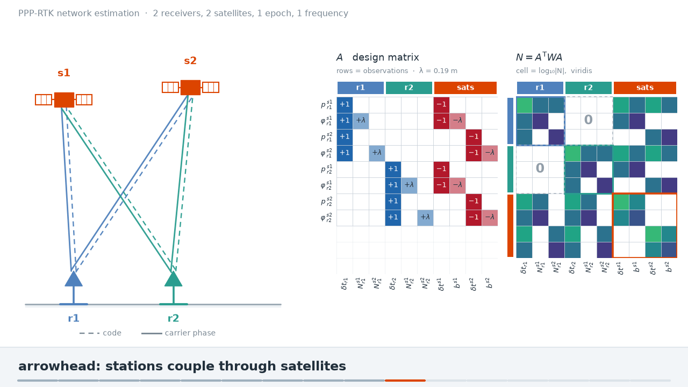
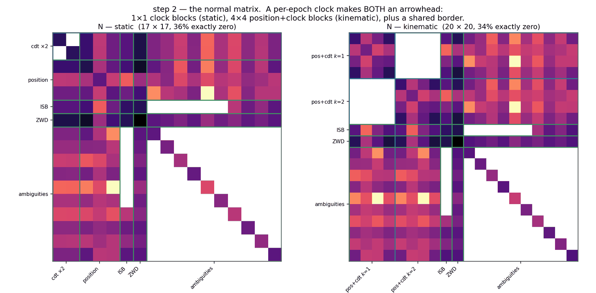
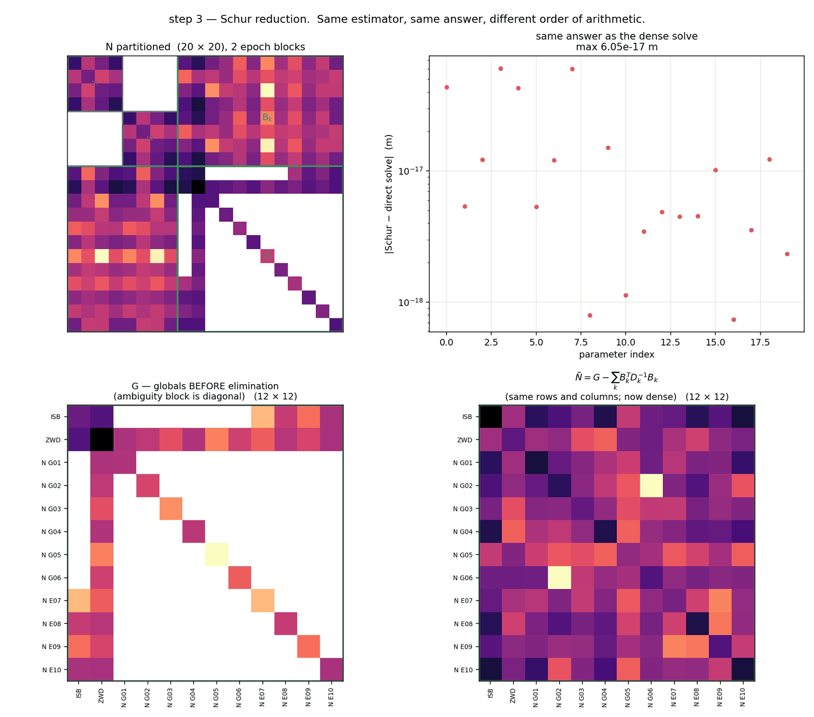
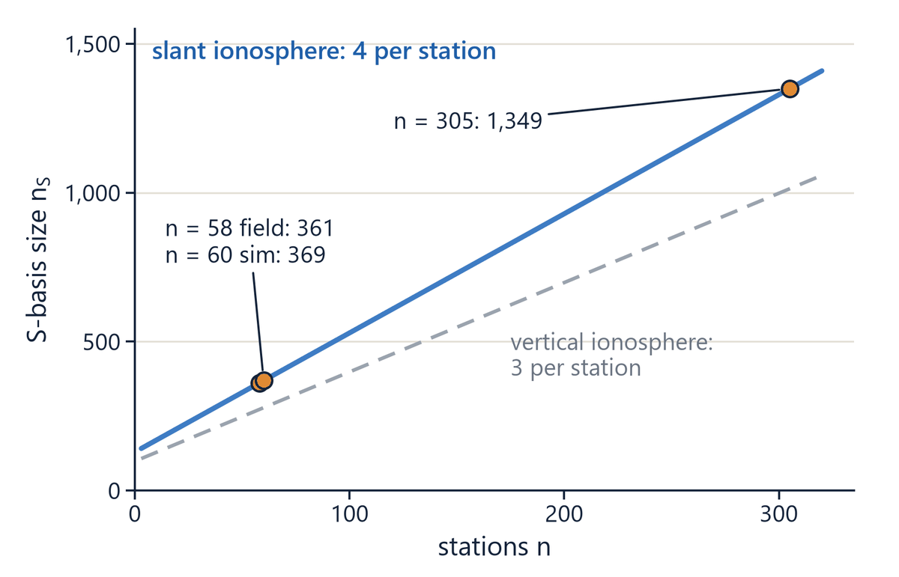

# Workbook module 1 · The observation model and the rank deficiency

**Goal:** the network's undifferenced, uncombined equations; the unknowns of one station and of
the whole network; how many directions no data can determine; and what the slant ionosphere
adds.
**Report step it bounds:** the section "One observation model" and the step 6 model paragraph
(the per-epoch check of undetermined directions).
**Time:** about 45 minutes.

## The idea

For receiver r, satellite s and signal j the network uses the code and phase equations of the
status report (equations su-code and su-phase), with nothing differenced and nothing combined:

```
P(r,s,j) = ρ + c(dt_r − dt^s) + c·δt_r(g(s)) + T + μ_j·I(r,s) + B_r,j − B^s_j + ε
Φ(r,s,j) = ρ + c(dt_r − dt^s) + c·δt_r(g(s)) + T − μ_j·I(r,s) + λ_j·N(r,s,j) + b_r,j − b^s_j + ε
μ_j = f1² / f_j²
```

The unknowns split in two (report step 6). The terms shared by all stations, `x_B`, are the
satellite clocks, code biases and phase biases. The terms of one station, `x_r`, are its
ambiguities, slant ionosphere, zenith wet delay, receiver clock, inter-system bias and receiver
code-bias difference. Stations meet only through `x_B`, so the normal matrix is an arrowhead
(figure 1.1) and each station block is eliminated exactly before the shared solve (figure 1.3).
A run prints its unknowns once, after the first emitted epoch, as the "parameters as armed"
table (`src/core/network/assembly/ParamInventory.cpp`, layout in
`include/network/assembly/ParamInventory.hpp`).

The equations cannot separate every term. For f frequencies, n receivers and m satellites,
Odijk et al. (2016) count the rank deficiency of this model by type
(`docs/cards/network-vehicle/SBASIS-THEORY-E.md`, §E2):

| Type | Coupling | Size |
| --- | --- | --- |
| 1a | receiver clock and satellite clock | 1 |
| 1b | receiver and satellite hardware biases, code and phase | 2f |
| 2a | receiver clock and receiver hardware bias | n − 1 |
| 3a | satellite clock and satellite hardware bias | m |
| 4 | receiver phase bias and ambiguity | f(n − 1) |
| 5 | satellite phase bias and ambiguity | f·m |

Their sum is Eq. 24 of the paper, `1 + 2f + (1 + f)(n − 1 + m)`. A slant ionosphere per line of
sight adds `n − 1 + m` (types 2b and 3b): the geometry-free code biases of each receiver and each
satellite merge into the slant ionosphere, `ι̃ = ι + d_r,GF − d^s_GF`. Position, zenith delay and
vertical ionosphere are estimable before any reference choice; clocks, biases and ambiguities
only as combinations (module 2).



*Figure 1.1. Toy network, two receivers and two satellites, one epoch, one frequency: the
design matrix A and the normal matrix N = AᵀWA. The two empty blocks show that the receivers
are linked only through satellite terms. Keyframe 06 of the concept animation.*



*Figure 1.2. The same shape in single-receiver PPP: a clock per epoch makes 1 × 1 (static) or
4 × 4 (moving receiver) epoch blocks around a shared border. Here epochs play the part that
stations play in the network. September 2026 illustration (`fig2_normal_matrix.png`).*



*Figure 1.3. Eliminating the epoch blocks first and solving the reduced border gives the direct
solution to 6e-17 m: the elimination is exact, not an approximation (`fig3_schur.png`).*



*Figure 1.4. Eq. 24 against the number of stations for one constellation of 32 satellites and
two frequencies: about four more undetermined directions per station with a free slant
ionosphere, three with a vertical one. Deck slide 6 (`slide06_4.png`).*

Sources: `docs/cards/network-vehicle/SBASIS-THEORY-E.md`, `docs/cards/network-vehicle/SBASIS-CONTRACT.md`,
`docs/refound/RF-NS_null_space_read_2026-09-15.md`, `include/network/assembly/ParamInventory.hpp`,
`include/network/solve/Sbasis.hpp`, `src/core/network/solve/RankGate.cpp`; the status report,
section "One observation model".

## Questions

### Q1.1 (read) The parameters as armed

Print the table of the simulated reference run (60 stations, GPS and Galileo, two signals each):

```
sed -n '658,686p' runs/_rf0hv15_sim6/stdout.txt
```

Map each unknown of the two equations above to a row of the table. Which term of the phase
equation has no state of its own, and what absorbs it? How many shared columns and how many
local columns does the run carry at its first epoch?

### Q1.2 (derive) Eq. 24 by hand

1. Sum the six types of the table to obtain Eq. 24, then add the slant term.
2. Figure 1.4 uses one constellation of 32 satellites and two frequencies with a slant
   ionosphere. Check its 369 directions for 60 stations, 361 for 58 and 1,349 for 305.
3. The first epoch of the simulated reference run has n = 60, m = 56 (32 GPS, 24 Galileo) and
   f = 2. What does Eq. 24 with the slant term give? The run's rank check prints
   `declared_dim=2` (line 640 of its stdout). Why 2 and not that number?

### Q1.3 (measure) Which directions are null

Run (about 9 s):

```
C:/Python313/python.exe -I scripts/rf_null_space_read.py runs/_rf0hv15_sim6
grep -n "rank gate evaluated" runs/_rf0hv15_sim6/stdout.txt
```

From the first-epoch eigen-census (also rows 2 to 6 of
`runs/_rf0hv15_sim6/logs/network_estimability.csv`): which two eigenvalues fall below the
cutoff, and what direction do eigenvector weights of 0.2040 on every Galileo clock and 0.1767 on
every GPS clock describe? How many decades lie between the cutoff and the larger of the two, and
between the cutoff and the weakest real direction? Does that meet the two-decade rule of
`src/core/network/solve/RankGate.cpp` (lines 408 to 410)? What does the run-end line report?

### Q1.4 (claim) One model, and a check every epoch

The report's first message says "one model and one filter carry every step", and step 6 says
"every epoch a check confirms that exactly the expected number of directions is left
undetermined". What may the presentation claim on these two points, and what may it not? Name
the evidence for each.
