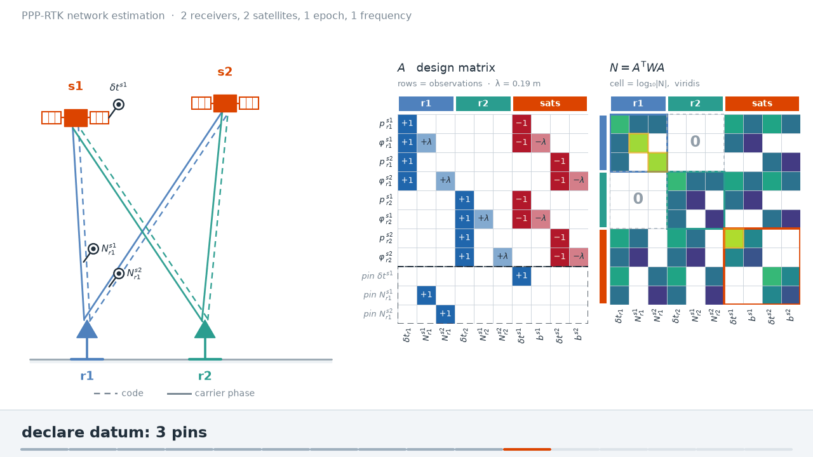
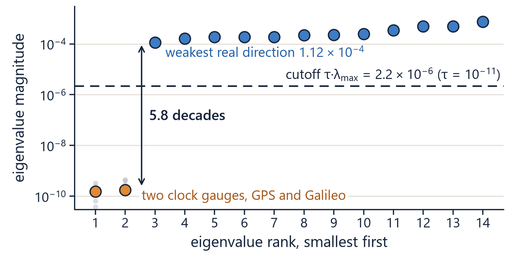

# Workbook module 2 · The S-basis and the four reference choices

**Goal:** what a reference choice (datum, S-basis) fixes, why no admissible choice moves an
estimable quantity, which four choices the reference configurations make, and what the
per-epoch rank check proves and does not prove.
**Report step it bounds:** the step 5 table row "Reference choices, integers" and the step 6
model paragraph ("a few reference choices are fixed ... every epoch a check confirms ...").
**Time:** about 60 minutes. Module 1 comes first.

## The idea

Module 1 counted the directions of the network's equations that no data can determine. A
reference choice removes them: constraints `Bᵀx = 0`, or pins `x_i = value`, that pick one
solution among all those that fit the data equally well. The S-transformation
`S = I − V[(S⊥)ᵀV]⁻¹(S⊥)ᵀ` projects onto the estimable space along the null space `V`; its rows
are the estimable combinations, and the reference directions carry zero variance
(`docs/cards/network-vehicle/SBASIS-THEORY-E.md`, §E1).

**The datum-invariance theorem** (same section): an estimable function `fᵀx` (with `f` in the
range of `Aᵀ`) has the same value and the same variance under every admissible reference choice.
A reference choice decides which combination is reported as "the satellite clock"; it cannot
change what the data measure.

The record names four kinds of reference choice (§E3): a **pin** (one parameter set to a value),
a **prioritized anchor** (one pin per satellite and signal, held for a tenure), a
**sum-to-zero** row (the mean over a set), and an **ensemble** (an inner constraint over all
receivers). They differ in how they behave when the set of satellites changes and in whether
integer double differences survive. The ensemble was measured dead and deleted on 2026-10-14.

The reference configurations combine four choices:

| Choice | What it fixes | Settings (`config/golden/golden_sim_refound.json`) | First epoch, simulated case |
| --- | --- | --- | --- |
| Clock pin | one satellite clock per constellation, the pivot | no key (the default); `sticky_pivot`, `handover_stransform` | 2 pins (E02, G01) |
| Prioritized phase anchors with the held basis | one ambiguity per satellite and signal, frozen at its basis value | `phase_datum_prioritized`, `phase_datum_held_basis`, `ambiguity_vehicle` `float_kf` | 112 ambiguity pins on 18 stations |
| Code-bias datum | per satellite the ionosphere-free pin and the geometry-free pin at the broadcast T_GD; per signal the sum-to-zero rows | `estimate_sat_code_bias`, `sat_gf_datum` `broadcast_tgd`, `sat_gf_datum_time_linked` | 56 + 56 rows; sum-to-zero rows suppressed |
| Zero-mean receiver DCB prior | the mean of the receivers' code-bias differences, σ 10 m | `rx_code_bias_datum`, `station_prior_before_pd` | 120 prior entries on 60 stations |

**The rank gate.** Every epoch the solver counts the eigenvalues of the reduced shared normal
matrix below `rank_gate_tol` × λ_max and requires exactly the declared number: 2, one clock
direction per constellation, because the clock pins act after the gate. A mismatch triggers a
heal, one re-check and then a withheld epoch. S-basis completion (`sbasis_complete`) folds one
row per extra, separable near-null direction; on both reference cases it folded none in 720
epochs.

**What the shared check cannot see.** Each station keeps one level direction per constellation:
its slant ionosphere, receiver geometry-free code biases and ambiguities shifted together. The
direction is local, eliminated before the shared solve, and held only by the 10 m receiver DCB
prior (about 116 m along the level) and by the carried coupling rows (about 0.1 m). It carried
the GPS L5 event of card R1D into the shared solution through the station's anchored phase
biases (card ALD).



*Figure 2.1. Toy network (two receivers, two satellites, one epoch, one frequency): eight
observations, ten unknowns, three free directions, removed by three pins (the clock of s1 and
the ambiguities N^s1_r1, N^s2_r1). Keyframe 07 of the concept animation
(`D:\GnssProcessorSupport\presentation\figures\network_concept.gif`).*



*Figure 2.2. The rank gate on the first real-data epoch: the 14 smallest eigenvalues of the
414 × 414 reduced shared normal matrix. Two lie near 1e-10 (the two clock directions, GPS and
Galileo); the weakest real direction is 1.12e-4, 5.8 decades higher; the dashed line is the
cutoff `rank_gate_tol` × λ_max. Deck slide 7 (`slide07_2.png`).*

Sources: `docs/cards/network-vehicle/SBASIS-THEORY-E.md`, `docs/cards/network-vehicle/SBASIS-CONTRACT.md`,
`docs/refound/RF-0b_dcb_datum_2026-09-15.md` to `RF-0e_level_datum_2026-09-15.md`,
`docs/refound/R1D_station_level_datum_2026-10-23.md`, `docs/refound/ALD_anchor_level_datum_2026-10-23.md`,
`include/network/solve/Sbasis.hpp`, `include/network/solve/PhaseDatum.hpp`,
`include/network/carry/RxCodeBiasCarry.hpp`, `src/core/network/solve/RankGate.cpp`.

## Questions

### Q2.1 (read) The theorem, and what is estimable before any choice

Read the boxed theorem of `SBASIS-THEORY-E.md` §E1 and the paragraph "Datum-invariant even
before choosing a datum" of §E2.

1. What exactly is invariant, and under which choices?
2. Which of these are estimable before any reference choice: position, zenith tropospheric
   delay, vertical ionosphere, a satellite clock, a satellite phase bias?
3. The record measured a differential satellite clock wander of about 47 cm before the
   re-founding. Why could no change of clock or phase reference cure it, and what kind of change
   can?

### Q2.2 (read) Four kinds of reference choice

First confirm that the reference configurations are the generated ones:
`C:/Python313/python.exe scripts/make_golden_config.py --verify`. Then, from §E3 of
`SBASIS-THEORY-E.md` and `config/golden/golden_sim_refound.json`: for a pin, a prioritized
anchor, a sum-to-zero row and an ensemble, how does each behave when a satellite rises or sets,
and does it keep the user's double-difference ambiguities integer? Which of them does the
reference configuration use, through which keys, and which datum-looking keys are absent from
the file?

### Q2.3 (derive) Counting the rows of the first epoch

The simulated reference case sees 56 satellites (32 GPS, 24 Galileo) at 60 stations on its first
epoch, with two signals per constellation. Each satellite carries one clock, two phase biases
and two code biases in the shared state.

1. How many shared columns are there?
2. How many rows does each of the four choices contribute (clock pins, ambiguity pins, code-bias
   rows, receiver prior entries), and how many in total?
3. The rank gate's declared dimension is 2, not 0. Why? What does the solver do on an epoch
   where the count differs, and what would S-basis completion have added?

Check the counts against lines 631 and 679 to 738 of
`D:/GnssProcessorSupport/runs_nom/_rap_scb_g_q6/stdout.txt`, and the run-end line
`grep -n "datum graph gate" D:/GnssProcessorSupport/runs_nom/_rap_scb_g_q6/stdout.txt`.

### Q2.4 (measure) Do the published code biases carry an estimate?

The code-bias datum pins, for every dual-frequency satellite, the ionosphere-free combination of
its two code biases and their geometry-free combination at the broadcast group delay T_GD. Read
the first epoch's code-bias records of G05 in the simulated reference case and the G05 record
of the broadcast navigation file:

```
grep -n -m2 '^B,G05,' D:/GnssProcessorSupport/runs_nom/_rap_scb_g_q6/products.txt
sed -n '562,568p' data/2024-129/products/BRDC00IGS_R_20241290000_01D_MN.rnx
```

What is the ratio of the C2W record to the C1C record, what is their ionosphere-free
combination, and how does the C1C record compare with c·T_GD from the navigation record? What
does that say about where the satellite's true code bias goes in the network solution, and why
must a user apply the code biases and the network's ionosphere (or its own) as a pair?

### Q2.5 (derive) The direction the shared check cannot see

Card R1D (§1) gives the loadings of the GPS level direction of station MAJU00MHL: the receiver
DCB carries a share of 0.0074 of the unit direction, the band-5 code delay 0.2392² and the
second-channel offset 0.1334². The receiver DCB prior has σ 10 m.

1. What standard deviation does the DCB prior alone give along the unit level direction? Check
   the card's "about 116 m".
2. A zero-mean row on the band-5 delay and the second-channel offset at the same σ would add
   information. By how much would the information grow? Check "about eleven times".
3. Card ALD (§3) gives vᵀNv = 110 per unit level for the coupling rows. What σ follows, and which
   rows hold the level?
4. Why can the shared rank gate (Q2.4) never see this direction, and how did it carry the GPS L5
   event into the corrections?

### Q2.6 (claim) What may be said about reference choices

The report says the reference choices are "stated in the correction file and checked every
epoch" and that "a few reference choices are fixed (one reference clock per satellite system, a
few code biases and ambiguities)". What may the presentation claim on this point, and what may it
not? Name the evidence for each.
