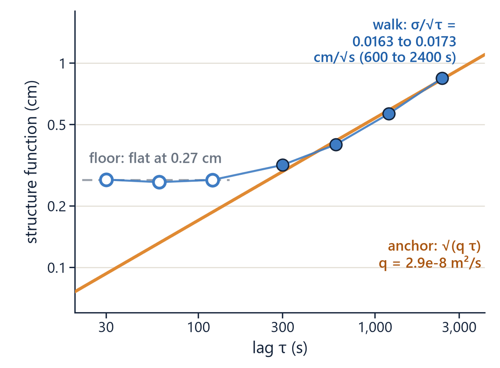
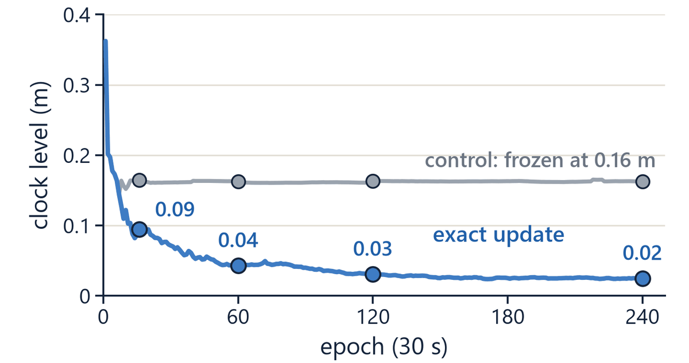
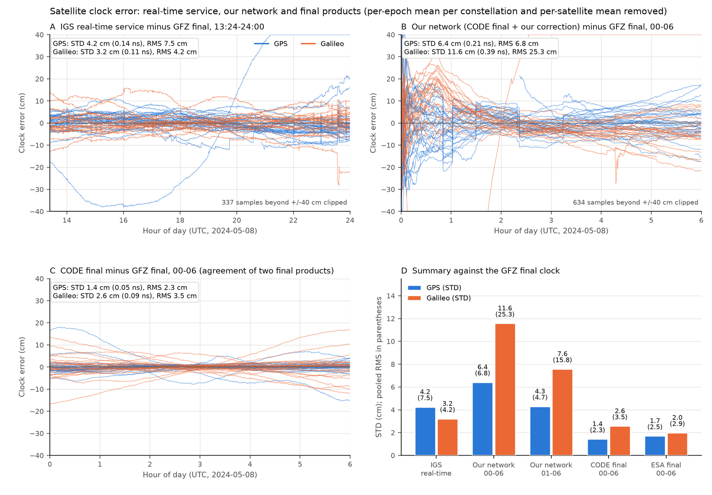

# Workbook module 4 · The satellite clock

**Goal:** how the network ties each satellite clock to its past, what the phase-clock hold
passes to a user, and why the precision of the network's clock today is the a priori clock
product's.
**Report step it bounds:** step 5 (clock precision measured) and the next step "satellite
clocks free of final products".
**Time:** about 60 minutes. Modules 2 and 3 come first.

## The idea

Only a reference-dependent combination of each satellite clock is estimable (module 2). Its
per-satellite part reaches the user; a part common to all satellites of a system is absorbed
by the user's receiver clock (module 3). Three mechanisms shape the per-satellite part.

1. **The temporal anchor** (card Q3, `network.clock_temporal_anchor`). Without it the clock is
   re-estimated from each epoch's data: the step between epochs was 9.23 cm per 30 s, because
   the clock's own process noise (`sat_clock_q`, 1e-3 m²/s) never binds. The anchor folds the
   previous epoch's clock in as a prior with variance `max(var + q·Δt, floor)`, with
   `clock_anchor_q` = 2.9e-8 m²/s. The value was measured, not chosen: the structure function of
   the clock correction is flat at about 0.27 cm out to two minutes, then grows as √(q·τ)
   (figure 4.1).
2. **The exact coupling update** (card CTU, `carry_coupling_exact_update`). Carried station rows
   used to age the clock at 1e-3 m²/s while the shared solve folded it at 2.9e-8 m²/s, which
   froze the clock level; the exact update lets the level converge at the anchor's rate
   (figure 4.2).
3. **The phase-clock hold** (cards PBH and LAH, `emit_pb_hold_phase_clock`). Between declared
   resets the network keeps each satellite's clock minus phase bias, C − P, constant up to a
   common mode. A user's phase rows then follow the a priori clock's motion, not the network's
   estimate. The configuration loader refuses the hold with the native broadcast a priori
   (`network.apriori_source` `sp3_brdc_clock`).

Card SCB (closed 2026-10-24) made the consequence measurable on a simulated data set with
injected satellite clock error (offset σ 0.5 m, rate σ 1e-5 m/s, random walk 3e-8 m²/s). With
the reference configuration the clock error grows with each satellite's drawn rate (clock level
5.3 cm at hour 6), and the user inherits the a priori clock's error through the hold: an hourly
median of 0.20 to 0.34 m, where on the quiet data set the same configuration's user stays
within 0.9 cm of a user of perfect corrections (module 6). Two postures that are not armed,
the self-contained regime (clock clone, shared history, q 5e-6 m²/s, smoothed hold) and the
native broadcast-clock posture (no CLK file), estimate the clock to about 2 cm whatever the a
priori clock's error.

On real data (report step 5, figure 4.3) the network's corrected clock is noisier against GFZ
than CODE's clock alone (GPS STD 4.3 cm over 01:00 to 06:00, against 1.4 cm for CODE over 00:00
to 06:00), and the correction is uncorrelated with CODE minus GFZ (|r| ≤ 0.18): it carries code
noise, not clock information.



*Figure 4.1. Structure function of the network's satellite clock correction against lag
(log-log): a floor of 0.27 cm from 30 to 120 s, then growth along the anchor's line √(q·τ) with
q = 2.9e-8 m²/s. Deck slide 11 (`figures/deck/slide11_1.png` of the status report).*



*Figure 4.2. Simulated network, error of the satellite clock level (the part no reference
choice removes) by epoch (30 s), graded from 00:30:15: the control freezes at 0.16 m, the exact
coupling update falls to 0.02 m by epoch 240. Deck slide 10 (`slide10_3.png`).*



*Figure 4.3. Satellite clock error against the GFZ final clock after removing the per-system
epoch mean and each satellite's mean: (A) IGS real-time service, 13:24 to 24:00; (B) our
network, CODE final plus our correction, 00:00 to 06:00 including the first hour; (C) CODE final;
(D) summary. Status report figure, `results/t3/fig_clock_limits_plain.png`.*

Sources: `docs/cards/clock/Q3-ANCHOR-DESIGN.md`, `docs/cards/clock/Q3-PHYSICAL-FLOOR.md`,
`docs/refound/CTU_coupling_time_update_2026-09-28.md`, `docs/refound/PBH_phase_bias_hold_2026-09-19.md`,
`docs/refound/LAH_level_aware_hold_2026-09-29.md`, `docs/refound/SCL_self_contained_clock_level_2026-10-03.md`,
`docs/refound/SCL2B_shared_history_with_the_hold_2026-10-07.md`,
`docs/refound/NBP_native_broadcast_clock_posture_2026-10-07.md`,
`docs/refound/SCB_sim_clock_error_bed_2026-10-24.md`, `include/network/solve/ClockAnchor.hpp`,
`include/network/emit/PbHold.hpp`.

## Questions

### Q4.1 (derive) A spectral density read as a step and as a time constant

`clock_anchor_q` is 2.9e-8 m²/s and the epoch is 30 s.

1. What is the 1σ random-walk step per epoch, and the 1σ accumulation over 6 h?
2. The injected rate on the clock data set has σ 1e-5 m/s, 0.30 mm per epoch, which card SCB
   calls "inside the golden anchor's permitted 0.93 mm per epoch". After how many epochs does a
   1e-5 m/s drift exceed the walk's 1σ accumulation, and why does a step-size comparison not
   guarantee tracking?
3. Treat the anchored clock as a scalar random walk observed once per epoch with noise variance
   R = (9.23 cm)²/2 (the pre-anchor step is the difference of two independent epoch estimates).
   With the steady-state gain K = √(q·Δt/R) of `docs/cards/raim-qc/DAY129-FRAME-ANATOMY.md`
   lines 138 to 143, what are K, the time constant Δt/K, and the error a 1e-5 m/s drift leaves?
   Compare with the coefficient card SCB measured for the reference configuration (2127 s).

### Q4.2 (derive) What the phase-clock hold passes to the user

`include/network/emit/PbHold.hpp` (lines 60 to 66) writes the held phase bias of satellite s as
`P(t) = p(t0) + [c̃(t) − c̃(t0)]`, with `c̃ = c − M` the estimated clock minus its system mean.

1. Show what `C − P` is between resets, and what a user's phase rows therefore see when the a
   priori clock is `a(t)` and the truth is `a(t) + err(t)`.
2. On the clock data set err(t) is a rate (σ 1e-5 m/s) plus a random walk (3e-8 m²/s). What rms
   error does the hold pass to the phase rows in hour 6 (5 to 6 h after the reset)? Compare
   with the value card SCB section 8 measured (GPS 0.201 m).

### Q4.3 (read) Where the hold's precondition is enforced

The record says the phase-clock hold "is valid only with a precise a priori clock product".
Which lines of `src/core/config/GnssConfigLoadNetwork.cpp` enforce it, what do they do for
`network.apriori_source` `sp3_brdc_clock` and for `brdc_rts`, and which token of the header line
of reference choices (S line, module 3) tells a user which hold is in force? What did the
precondition cost on real data when it was ignored (card SCL)?

### Q4.4 (measure) Two postures on the clock data set

Run the clock grader on the reference case and on the self-contained regime, both on the clock
data set (a few seconds each):

```
C:/Python313/python.exe -B scripts/simnet_clock_truth_grade.py --fixture D:/GnssProcessorSupport/fixtures/simnet60_clk_col_24h --run D:/GnssProcessorSupport/runs_nom/_rap_scb_g_k6
C:/Python313/python.exe -B scripts/simnet_clock_truth_grade.py --fixture D:/GnssProcessorSupport/fixtures/simnet60_clk_col_24h --run D:/GnssProcessorSupport/runs_nom/_rap_scb_c_k6
```

Read for each: the clock level at hour 6, the rms of the per-satellite mean errors, the
correlation of the mean error with the drawn rate, and the user's hourly error in hours 3 to 6.
Which posture follows the drift? Why is the user's error of the reference case so much larger
than its clock error? What do these lines not show?

### Q4.5 (claim) What step 5 may say about the satellite clock

For each statement, may the presentation make it, and what evidence bounds it?

1. The network's satellite clock is more precise than the IGS real-time clock.
2. On simulated data the network's clock is within a few centimetres of truth.
3. The user's phase sees CODE's final clock because each satellite's phase bias is held
   constant.
4. Without CODE's final clock, a user is 1.7 cm worse.
5. The network no longer depends on an outside clock product.
