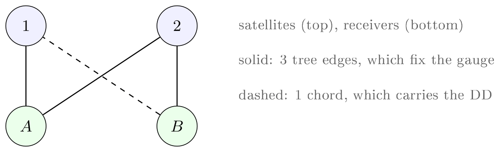
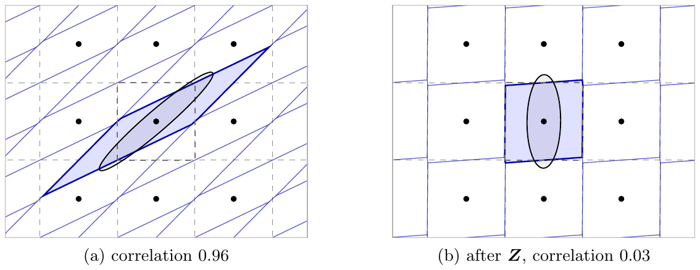

# Workbook module 5 · Float ambiguities and integers

**Goal:** why the network keeps its ambiguities float, what a complete set of integers would
buy, why the integer work done so far gives a user nothing yet, and what may be claimed.
**Report steps it bounds:** step 3 (integer fixing with outside corrections), the step 6 result
"42 % of the eligible ambiguities ... were fixed, none wrongly", and the next step "integer
ambiguities".
**Time:** about 50 minutes. Modules 2 and 3 come first.

## The idea

In the uncombined model every phase row carries both the slant ionosphere and an ambiguity, and
on GPS L1 and L2 the two enter in nearly the same direction. One cycle added on both bands moves
the phase by (λ1, λ2) = (0.1903, 0.2442) m; the ionosphere moves it along (1, μ2) with
μ2 = (f1/f2)² = 1.6469. The angle between the two directions is about 6.66°: an L1 + L2 integer
step is mostly indistinguishable from ionosphere, and with a free slant ionosphere per line of
sight the integers become visible only once the double-differenced ionosphere is known to about
0.1 L1 cycle.

The re-founding chose the **float vehicle** (card RF-1): each ambiguity is a float state of its
station block, with a joint covariance, a floored birth prior, a bounded drop and zero process
noise; double differences are integer in truth, single differences are not; integers are
graded, not fixed (`network.ambiguity_vehicle` `float_kf`, `network.phase_datum_held_basis`).
Three later results bound what integers can do for a user:

- **The oracle pin** (simulation, `docs/SPEC_oracle_pin.md`): pinning every ambiguity of a line
  of sight to its true integer collapses the double-difference-invariant L1 slant ionosphere
  error from 0.42 to 0.04 m; pinning only some of them makes it worse.
- **The fixed-cycle fold** (card FCF, ledger FCFC section 9): folding fixed integers back into
  the solution moved the test station by 0.2 %; the zero-noise float already integrates the
  whole arc, and the published biases are not integer for a user.
- **The integer-recovering datum** (card IRD, open): a user's single difference is integer if
  and only if every published bias difference is; pinning a spanning tree of each observation
  graph to integers, plus one real-valued receiver phase-bias root, would give that property.
  The reference configuration's phase datum does not.

On the simulated network a search on the network's own float states (card ARL, written to the
log only) fixed 42 % of the settled double differences of one case, none wrongly, while the
published phase biases stay at the uniform null.



*Figure 5.1. The smallest observation graph with a cycle: satellites 1 and 2 (top), receivers A
and B (bottom). The three solid arcs form a spanning tree whose ambiguities the reference choice
fixes; the dashed chord carries the one double difference the data determine
(`docs/report/network_carry.pdf`, figure 1).*



*Figure 5.2. A two-dimensional integer search. (a) At correlation 0.96 the error ellipse (black)
is long and thin, and the shaded pull-in region of the search is a long parallelogram, unlike
the unit squares of rounding (dashed). (b) After the decorrelating transformation Z the
correlation is 0.03 and the pull-in region is nearly the rounding square. Generic illustration
(not this project's data) from `docs/report/linear_algebra.pdf`, figure 3, also on the claude.ai
page "Linear Algebra in GNSS".*

Sources: `docs/refound/RF-1_float_ambiguities_design.md`, `docs/refound/RF-1_decision_2026-09-14.md`,
`docs/SPEC_oracle_pin.md`, `docs/refound/FCF_fixed_cycle_fold_2026-10-11.md`,
`docs/refound/FCFC_fixed_cycle_ledger_2026-10-11.md`,
`docs/refound/IRD_integer_recovering_datum_2026-10-13.md`,
`docs/refound/ARL_integer_ambiguity_ladder_2026-10-09.md`,
`docs/network_ambiguity_resolution_design.md`, `docs/cards/raim-qc/T3-IONO-MECHANISM.md`.

## Questions

### Q5.1 (derive) Why "99.3 % ionosphere"

From f1 = 1575.42 MHz and f2 = 1227.60 MHz: compute λ1, λ2 and μ2, the angle between the
ionosphere direction (1, μ2) and the common-cycle direction (λ1, λ2) in metres of phase, its
cosine, and the part of one common L1 + L2 cycle step that is orthogonal to the ionosphere. Is
"99.3 %" (card ARL, line 43) a share of amplitude or of variance?

### Q5.2 (derive) An ionosphere error in cycles

A double-difference L1 ionosphere error d (metres) is absorbed by the ambiguities.

1. What are the L1 and wide-lane (L1 − L2) errors in cycles for d = 0.4233 m (no pin) and
   d = 0.0419 m (complete pin)?
2. Instantaneous resolution needs about 0.1 L1 cycle. What is that in metres and in TECU, and by
   what factor does the no-pin case miss it?

`docs/cards/raim-qc/T3-IONO-MECHANISM.md` (lines 326 to 331) gives the cycles-per-metre factors
to check against.

### Q5.3 (read) Complete and partial pins

Read sections 0 and 8.1 of `docs/SPEC_oracle_pin.md`. What is the "integer-information deficit",
which row of its table carries it, and why is the raw per-line-of-sight error (2.73 m) the wrong
row? What do the partial pins (L5Q alone; L1C with L2W; one station; one satellite) show, and on
which simulated data set were these numbers produced?

### Q5.4 (measure) Integers in the float, none in the corrections

Run (each under 10 s):

```
C:/Python313/python.exe scripts/simnet_wire_integer_consistency.py runs/simnet60_quiet_col_24h --run runs/_rf0hv15_sim6 --bands L1C,L2W --systems G --wl --nl --null-mc 500 --start-hms 00:30:15
C:/Python313/python.exe scripts/simnet_producer_ar_grade.py runs/simarl_r2 --run runs/_rap_arl_r2dp --settle-h 1
```

The first grades the published GPS phase biases of the simulated reference run for integer
consistency (the fractional part of wide-lane and narrow-lane combinations against a uniform
null; a set of perfect corrections reads 0.000). The second grades the log-only integer search
of card ARL. What does each print, and what do the two together say about where the integers
are?

### Q5.5 (claim) What may be said about integer ambiguities

The report says, on simulated data, "42 % of the eligible ambiguities (between pairs of stations
and satellites) were fixed, none wrongly", and on real data "no integers are fixed". What may the
presentation claim about integers, and what may it not? Consider the case behind the 42 %, the
published corrections, the fixed-cycle fold, producer-side fixing and the user side of step 3.
