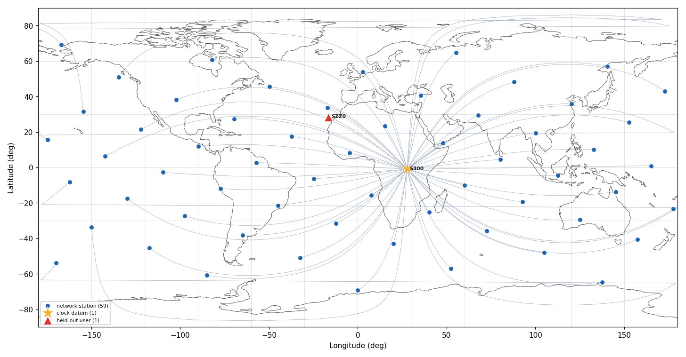
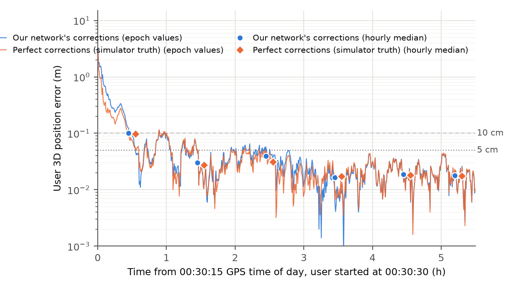
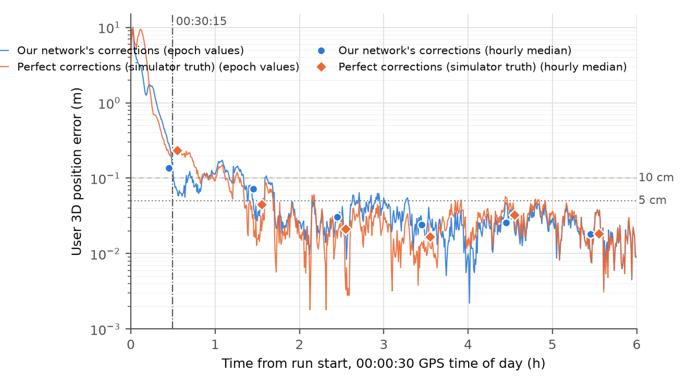

# Workbook module 6 · The simulated network

**Goal:** what the simulated network certifies and what it cannot; where a simulated run starts
and where it is graded; how truth is put into the network's own reference choices; and how much
error the network adds on top of the user's own floor.
**Report step it bounds:** step 6 ("Our network, on simulated data").
**Time:** about 50 minutes. Modules 2 and 4 come first.

## The idea

The simulated data set `runs/simnet60_quiet_col_24h` holds 60 network stations and the test
station SZZ000SIM, at 30 s from 00:00:30 (figure 6.1). It is **quiet**: no cycle slips (its 61
`truth_slips.csv` files hold no rows) and no satellite clock error. Its truth clock is the CODE
product that the network also takes as its a priori clock, so the network's clock correction is
zero in truth (card SCB, §1). A simulation grades what it injects, plus contrasts in which every
reused term cancels (card SIMNET-REF). Card SCB added a second data set with clock error,
`D:/GnssProcessorSupport/fixtures/simnet60_clk_col_24h` (module 4). Numbers are never compared
across simulated data sets.

**The start artifact.** The simulator extrapolated the satellite positions outside its SP3
window for its first epochs. The reference case is therefore graded from 00:30:15 (bins from
tow 261015), and a case with `network.start_offset_hours` 0.504167 starts at 00:31:00, half an
epoch after the offset. A run that starts at 00:00:30 keeps what those epochs drew: the
published simulated baseline's clock carries per-satellite constants of 0.32 m rms, against
0.019 m in a run started at 00:31:00 (card SCB, §7). A float user cannot see a per-satellite
constant (module 3), so the user's error barely notices.

**Grading in the network's own reference choices.** The network reports its clocks and biases in
its realized reference choices (pivots, code-bias pin pairs, geometry-free datum, all declared
on the S line). Truth is transformed into that basis before the comparison; the estimate is not
differenced, which would bias the variance factor downward (SIMNET-REF). The clock grader
`scripts/simnet_clock_truth_grade.py` also removes the per-epoch, per-constellation median, the
clock direction no data fix.

**Perfect corrections and the user floor.** The simulator knows every clock and bias, so a set
of perfect corrections can be written (`scripts/simnet_truth_wire.py`; it grades exactly 0) and
the same test station positioned with both sets, by the same software. Status report step 6
(card T2): with the user restarted at 00:30:30 the two users differ by at most 0.9 cm per hour
(hour 3) and by nothing measurable in hours 4 to 6 (figure 6.2). The remaining 1.7 to 1.8 cm is
in the height and appears with both sets: it belongs to the user side. Counted from 00:00:30,
the user with perfect corrections looks worse in hour 1 (23.5 against 13.7 cm, figure 6.3); the
cause of that reversal was not tested.



*Figure 6.1. The simulated network: 59 stations (dots) and the clock-datum station S30000SIM
(star) form the 60 network stations; the test station SZZ000SIM (triangle) is left out and
positioned as a user. Lines join each station to S30000SIM. September 2026 dashboard, deck
slide 15 (`slide15_1.png`).*



*Figure 6.2. Test station SZZ000SIM positioned with our network's corrections (blue) and with
perfect corrections (orange), user started at 00:30:30; lines are epochs, markers hourly
medians. Status report, `results/t2/plain/t2_sim_floor_restart.png`.*



*Figure 6.3. The same comparison counted from the run start, 00:00:30, with the 00:30:15 grading
origin marked: in hour 1 the user of perfect corrections is worse. Status report,
`results/t2/plain/t2_sim_floor.png`.*

Sources: `docs/cards/sim-bed/SIMNET-REF.md`, `docs/refound/SCB_sim_clock_error_bed_2026-10-24.md`,
`docs/refound/CTU2_level_recursion_followup_2026-09-29.md`, `docs/cards/queues/QPR-ITEMS-5-8.md`,
`CLAUDE.md` ("Sim start", "Conventions shared end to end"); status report step 6 and
`results/t2/results.md`.

## Questions

### Q6.1 (read) What the quiet data set cannot test

The report's limits box for step 6 says the simulation "adds no error to the satellite clocks".
Read card SCB §1 and the start of §2 (lines 17 to 25) and `results/t2/results.md` (lines 123 to
126). What exactly
makes the clock untestable on the quiet data set, and what does its 0.9 cm agreement certify
instead? Check the absence of injected clock error directly:

```
ls runs/simnet60_quiet_col_24h/*/truth_satclock.csv 2>/dev/null | wc -l
ls D:/GnssProcessorSupport/fixtures/simnet60_clk_col_24h/*/truth_satclock.csv | wc -l
```

### Q6.2 (derive) Where a simulated run starts

1. The simulated data set's first epoch is tow 259230 (00:00:30). An epoch is reached when its
   elapsed time since the first epoch is at least the offset (`include/math/TimeUtils.hpp`,
   lines 416 to 448). At which tow and time do `network.start_offset_hours` 0.504167 and
   0.4958333333 start a run? What does "half-epoch back-off" mean here?
2. Count the extrapolated epochs of the start artifact. The geometry log warns only when the
   extrapolation exceeds half the SP3 interval (`src/core/model/ModelGeometry.cpp`, line 1204):

```
grep "Position extrapolation" runs/simnet60_quiet_col_24h/SZZ000SIM/logs/geometry.log | sed -E 's/.*tow ([0-9.]+):.*/\1/' | awk '{c[int(($1+15)/30)*30]++} END{for(e in c) print e,c[e]}' | sort -n
```

   How many epochs are logged, how many precede the SP3 window (which opens at tow 259500), and
   is "faulty in their first 30 minutes" the right description?

### Q6.3 (measure) The published baseline's clock in the network's basis

Run the clock grader on the published simulated baseline (started 00:00:30) and on the quiet
case of card SCB (started 00:31:00), about 2 to 10 s each:

```
C:/Python313/python.exe -B scripts/simnet_clock_truth_grade.py --fixture runs/simnet60_quiet_col_24h --run runs/_rf0hv15_sim6 --hours 6
C:/Python313/python.exe -B scripts/simnet_clock_truth_grade.py --fixture runs/simnet60_quiet_col_24h --run D:/GnssProcessorSupport/runs_nom/_rap_scb_g_q6
```

Compare the clock level by hour and the rms of the per-satellite mean errors. Rerun the first
with `--no-ds`: what does the datum share remove, and why is it added to the truth rather than
subtracted from the estimate? Why does the user of the first run not show the 0.32 m?

### Q6.4 (derive) The network's cost and the user's floor

From `results/t2/results.md` (lines 195 to 206), the hourly 3D medians with the user restarted at
00:30:30, in metres: perfect corrections 0.0983 0.0275 0.0311 0.0173 0.0181 0.0176; our network
0.1013 0.0301 0.0396 0.0166 0.0186 0.0178. Compute the network's cost per hour, the largest
cost, and the floor in hours 4 to 6. In which component does the floor sit
(`results/t2/metrics.csv`)?

### Q6.5 (claim) What step 6 may say

What may the presentation claim from the simulated network, and what may it not? Consider the
0.9 cm, the absent clock error, the start of the comparison, the hour-1 reversal, the number of
realizations, and the 42 % integer result printed in the same box.
