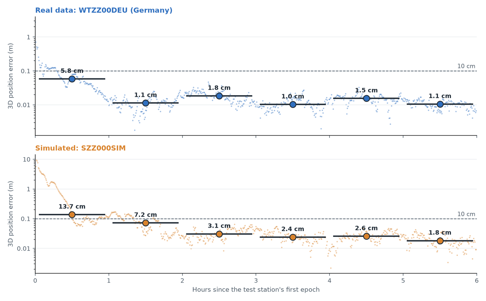
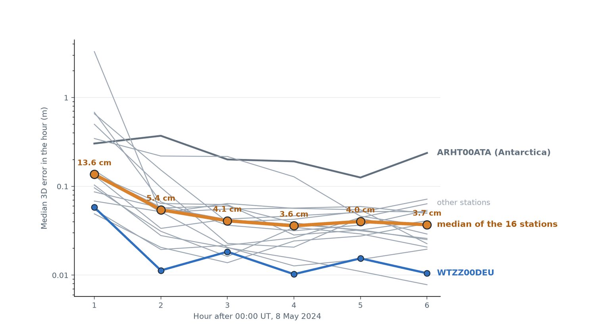
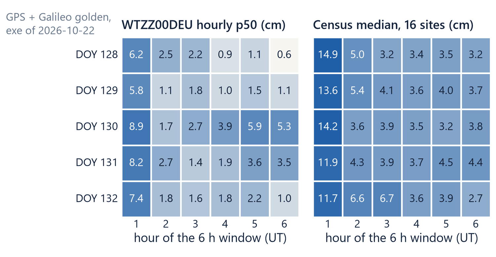
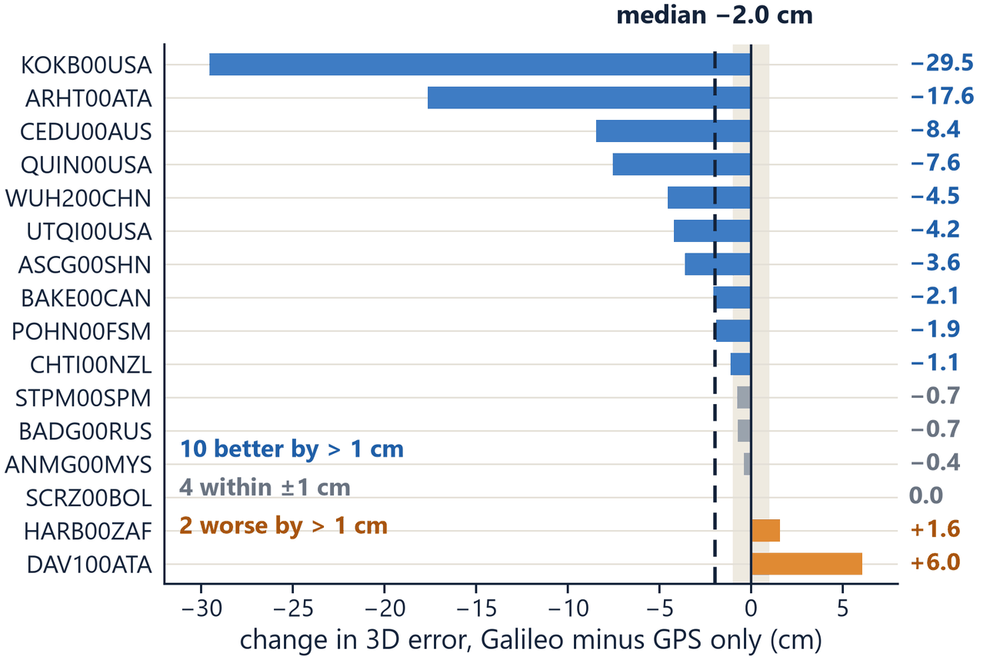
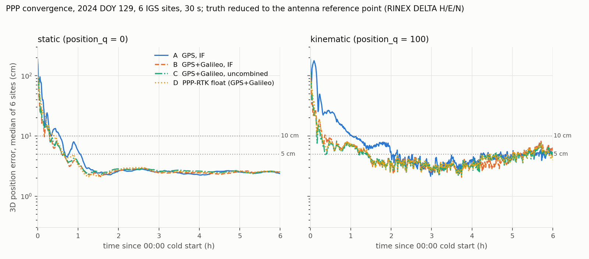

# Workbook module 7 · Real data and the claims

**Goal:** how the real-data result is graded (the test station by hour, 16 further stations,
five days), what the clock comparison with CODE and GFZ measures, what a clock free of final
products costs today, and the claim boundary of the meeting's three messages.
**Report step it bounds:** step 7, step 5's clock comparison and the three messages for the
meeting. The last question gathers the claim questions of modules 1 to 6.
**Time:** about 60 minutes. All earlier modules come first.

## The idea

The real-data reference case (`config/golden/golden_field_refound.json`, run
`runs/_rf0hv15_field6`) processes 58 IGS stations on 8 May 2024 (day 129), GPS L1/L2 and Galileo
E1/E5a, from 00:00. The test station WTZZ00DEU is left out of the network and positioned as a
moving receiver (`filter.process_noise.position_q` 100) from the network's clock and bias
records, without integer fixing and with its own float ionosphere: the corrections carry no
ionosphere record. Because the corrections are a file, 16 further stations, none of them in the
network, are positioned from the same file afterwards (`scripts/clock_level/gcensus.py`).

**Grading rules** (`CLAUDE.md`, "Network runs: start from a golden"). A change is graded as a
difference against the baseline pair and against an unchanged copy run by the same software, on
the test station by hour and on the 16 stations, never on one of them alone. Hour 1 is the first
hour after a cold start: settled claims come from hours 2 to 6.

**The numbers** (card GAD, report step 7, figures 7.1 to 7.4). WTZZ00DEU by hour: 5.8, 1.1, 1.8,
1.0, 1.5, 1.1 cm, 688 of 720 epochs below 10 cm. The 16 stations' median by hour: 13.6, 5.4, 4.1,
3.6, 4.0, 3.7 cm. Adding Galileo moved the median station by −2.0 cm in hours 2 to 6 (10 better,
2 worse). Five days, 7 to 11 May 2024, are stored in
`D:/GnssProcessorSupport/runs_nom/mday_galileo_grades.txt`.

**The clock against CODE and GFZ** (status report step 5, `results/t3/results.md`). The network
publishes its clock as a correction c0 to CODE's final clock. Against GFZ the corrected clock is
noisier than CODE alone, and c0 is uncorrelated with the difference between CODE and an
independent final clock (|r| ≤ 0.18): it carries code noise, not clock information. On the phase
rows the hold (module 4) lets the user see CODE's clock, so the user's phase precision is
CODE's.

**Without CODE's clock** (card NBP): the native broadcast-clock posture leaves the 16 stations
1.7 cm worse at the median over three days, of which about 1.0 cm is the broadcast clock itself.



*Figure 7.1. The test station positioned with our network's corrections: real data, WTZZ00DEU
(top), and simulated data, SZZ000SIM (bottom). Dots are epochs, bars the median of each hour.
Status report folder, `figures/fig_network_test_station.png`.*



*Figure 7.2. Median error in each hour for the 16 further stations positioned from the same
stored corrections (grey), their median (orange), WTZZ00DEU (blue) and ARHT00ATA (dark).
Status report folder, `figures/fig_network_16_stations.png`.*



*Figure 7.3. Five days, 7 to 11 May 2024 (days 128 to 132), hourly median error in cm: WTZZ00DEU
(left) and the median of the 16 stations (right). The labels "golden" and "census" are the
record's names for the reference configuration and the 16 stations. Deck slide 33
(`slide33_1.png`).*



*Figure 7.4. Change of each station's error in hours 2 to 6 when Galileo is added (Galileo
minus GPS only): median −2.0 cm, 10 stations better by more than 1 cm, 2 worse. Deck slide 19
(`slide19_1.png`).*



*Figure 7.5. Steps 1 to 3 for comparison: median over six IGS stations of the 3D error in the
first 6 h, static (left) and moving receiver (right), cases A to D. Status report,
`results/t1/fig_t1_convergence.png`.*

Sources: `docs/refound/GAD_galileo_adoption_2026-10-13.md`, `docs/refound/NBP_native_broadcast_clock_posture_2026-10-07.md`,
`docs/refound/MDR_multiday_replay_2026-10-05.md`, `docs/refound/NETWORK_REFOUNDING_2026-09-14.md`,
`CLAUDE.md`; the status report, steps 5 and 7, and `results/t1/results.md`, `results/t3/results.md`.

## Questions

### Q7.1 (measure) The test station and the 16 stations

Run (about 2 s and 14 s):

```
C:/Python313/python.exe scripts/rapid_arm.py score runs/_rf0hv15_field6 runs/_rf0hv15_sim6
C:/Python313/python.exe scripts/clock_level/gcensus.py grade galpc galp galpg
```

Read the test station's median error by hour on both data sets, the 16 stations' median by hour
and the paired Galileo result (better, worse, hour 1). By what factor is hour 1 worse than the
mean of hours 2 to 6, at WTZZ00DEU and at the median station? In which mode is WTZZ00DEU
positioned (`runs/_rf0hv15_field6/arm.json`: `filter.process_noise.position_q`,
`network.closed_loop.ar_mode`), and is any of the 17 user stations part of the network?

### Q7.2 (derive) Five days from the stored grades

`D:/GnssProcessorSupport/runs_nom/mday_galileo_grades.txt` holds, per day 128 to 132, the 16
stations' median by hour and WTZZ00DEU by hour. From hours 2 to 6 of the five days, compute the
median and the mean of the 25 sixteen-station medians and the median of the 25 WTZZ00DEU values.
Compare with the report's "median of the 16 stations 3.9 cm in hours 2 to 6, WTZZ00DEU 1.8 cm".
On which day is WTZZ00DEU worse than the median station in hours 4 to 6, and what does that do to
"WTZZ00DEU is the best station"?

### Q7.3 (read) The clock comparison with CODE and GFZ

Read `results/t3/table_clock_report.tex` and `results/t3/results.md` (the summary table and
lines 100 to 113). Which clock is compared with which, over which hours? Why is GFZ the reference
and not CODE? Are the report's "GPS 4.3 cm, Galileo 7.6 cm, against 1.4 and 2.6 cm" a comparison
over the same hours? What do the correlations of c0 with (GFZ minus CODE) and (ESA minus CODE)
say? Optional check (about 20 s, without `-I`):
`C:/Python313/python.exe D:/GnssProcessorSupport/presentation/status_update_2026-10-29/results/t3/t3_wire_c0_correlation.py`.

### Q7.4 (derive) What "1.7 cm worse without the final clock" contains

Card NBP §12 (lines 212 to 219) splits the native broadcast-clock posture's cost over days 130
to 132 into three steps: the regime +0.0024 m, removing satellite G01 −0.0007 m, the broadcast
clock in place of CODE's +0.0099 m. The pooled median of the whole change is +0.0171 m (line 176).
Why do the steps not add to the total? Which part is the clock's information? Against which
reference configuration, which days and which hours was the 1.7 cm measured, and what does hour 1
add?

### Q7.5 (claim) The three messages for the meeting

The report closes its storyline with three messages (status report lines 123 to 140). For each
message, which parts does the evidence of modules 1 to 7 support as worded, which need a
qualifier, and which should not be said? Name the evidence for each.
